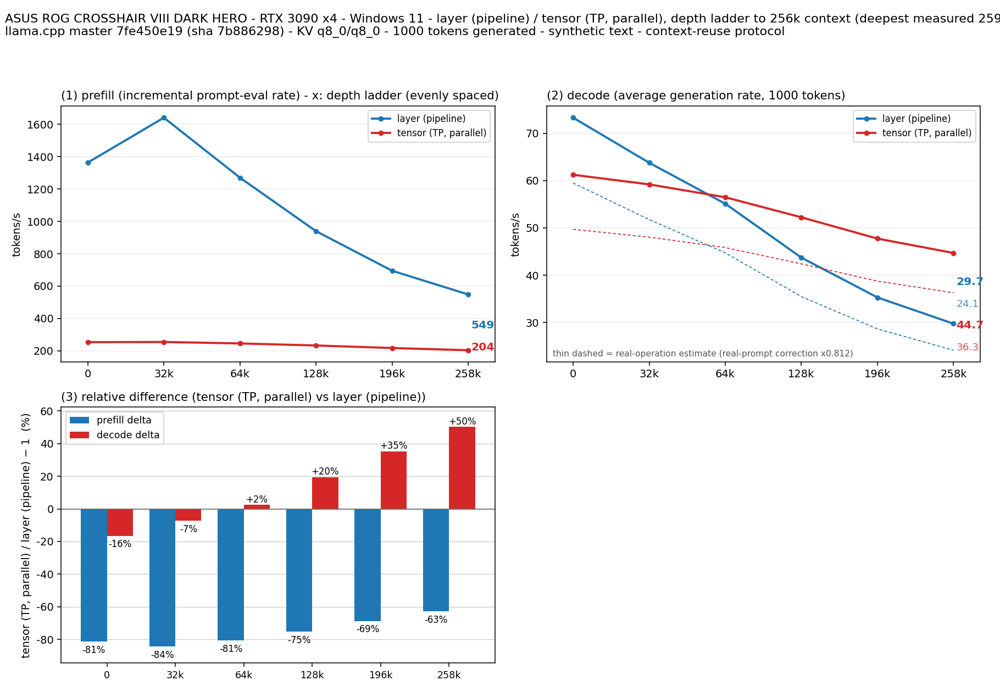

# RTX 3090 4 枚で Qwen3.8 27B の split-mode を比較（Windows・Gen4 x4・TCC）

- **作成者**: 錦幸佳
- **作成日**: 2026-10-18

## 概要

前回の Windows・PCIe Gen3 x4 測定と同じモデル・実行ファイル・測定引数を使い、PCIe Gen4 x4・TCC 有効の環境で再測定しました。
負荷時に全4枚の Gen4 x4 を確認しました。decode は64K段から tensor が速く、最深259,601トークンでは layer 29.74 tok/s、tensor 44.70 tok/sでした。

## ハードウェア

| 項目 | 内容 |
|------|------|
| コンピュータ / マザーボード | ASUS ROG CROSSHAIR VIII DARK HERO（前回構成を継続） |
| GPU | NVIDIA GeForce RTX 3090 × 4（VRAM 24 GB / 枚） |
| GPU 接続 | 全4枚とも負荷時 PCIe Gen4 x4 を確認。前回は Gen3 x4 |
| CPU | AMD Ryzen 9 5950X（前回記録） |
| メモリ | 128 GiB DDR4（前回記録） |

## ソフトウェア環境

| 項目 | 内容 |
|------|------|
| OS | Windows / build 26200 |
| GPU ドライバ | NVIDIA 610.88、全4枚で TCC 有効 |
| llama.cpp | b11146、commit 7fe450e19、公式 Windows CUDA 12.4 バイナリ。SHA256 は前回と一致 |

## ベンチマーク

### 条件

| 項目 | 内容 |
|------|------|
| ツール | llama-split-bench 7af72d4 の既存測定スクリプトと前回の Windows ランチャー |
| モデル | Qwen3.8-27B UD-Q4_K_XL、17,559,178,144バイト。SHA256 `3f227079003add2511437e5b1e94812e363385225bf6a9b47b0054a72bc8b01e` |
| 測定モード | layer / tensor（CUDA0,CUDA1,CUDA2,CUDA3、各1回、layer → tensor） |
| GPU動作条件 | コア1395 MHz固定設定、電力上限250 W／枚、メモリクロック固定なし |
| ctx / stages | 262144 / 0,32000,64000,128000,196000,258000 |
| KV キャッシュ | q8_0 / q8_0（draft KVも同じ） |
| 生成 | 各深度1,000トークン、合成テキスト |
| 投機的デコード | MTP有効、`--spec-type draft-mtp --spec-draft-n-max 2` |
| 主な共通引数 | `-b 2048 -ub 512 -t 8 -fa on --fit off` |

モデルとサーバーバイナリのハッシュを前回と照合しました。8Kコンテキストで両モードの動作確認後、本測定を実施しました。
本測定は10:13～10:45（日本時間）。測定中はGPU温度・電力・クロック・PCIeリンクと外部GPUプロセスを監視し、両モードとも正常終了しました。
1395 MHzは設定値です。瞬間的な実クロック低下を許容して記録する前回と同じ方式であり、全期間の実クロック一定を保証するものではありません。

### 結果

単位はtok/sです。目標深度0のprefillは別途測定したpp2048（実入力1,978トークン）の値です。11トークンの初期プロンプトのprefill値は使っていません。
同じ行のdecodeは初期プロンプトから1,000トークン生成した値です。他のprefillは各段で追加評価した入力の速度です。
図の推定線は実プロンプト測定に基づく補正値で、以下の表は補正前の実測値です。

| 目標深度 | 実測深度 | layer prefill | layer decode | tensor prefill | tensor decode |
|---:|---:|---:|---:|---:|---:|
| 0 | 11 | 1363.65 | 73.31 | 253.82 | 61.23 |
| 32,000 | 32,093 | 1641.10 | 63.77 | 254.97 | 59.20 |
| 64,000 | 64,806 | 1270.36 | 55.11 | 245.80 | 56.48 |
| 128,000 | 128,788 | 939.63 | 43.71 | 233.28 | 52.24 |
| 196,000 | 196,429 | 695.10 | 35.29 | 217.59 | 47.73 |
| 258,000 | 259,601 | 548.64 | 29.74 | 204.08 | 44.70 |

### 前回との比較・所感

前回Windows測定（[2026-09-27のレポート](2026-09-27_130914_comparing_qwen3.8_27b_split_modes_on_4x_rtx3090_at_1395mhz_on_windows.md)、本家PR #25）の最深部decodeはlayer 21.47、tensor 23.97 tok/sでした。今回はそれぞれ約38.5%、86.5%向上しました。
今回の最深部tensorはlayerより約50.3%速く、prefillは全深度でlayerが速い結果でした。
表のdecodeは合成テキストでの値で、MTPのdraft受理率は各段0.97～1.00とほぼ全受理でした。実プロンプト3件（`results-real.json`）では受理率0.53～0.77、decode 43.5～53.4 tok/sで、実用時のdecodeは表の値より低くなる可能性があります。
PCIe世代とTCCの条件が同時に変わっているため、どちらか一方の効果には分離できません。各モード1回の測定で、反復間のばらつきは未評価です。
Ubuntu・NCCLの前回測定（[2026-10-01のレポート](2026-10-01_203001_comparing_qwen3.8_27b_split_modes_on_4x_rtx3090_with_nccl_on_ubuntu.md)、本家PR #42）とはOS・ビルド・通信経路が異なるため、別条件として扱います。

## 添付

- [argv-layer.txt](attachment/2026-10-18_101353_comparing_qwen3.8_27b_split_modes_on_4x_rtx3090_with_gen4_x4_and_tcc_on_windows/argv-layer.txt)
- [argv-tensor.txt](attachment/2026-10-18_101353_comparing_qwen3.8_27b_split_modes_on_4x_rtx3090_with_gen4_x4_and_tcc_on_windows/argv-tensor.txt)
- [results-layer-pp0.json](attachment/2026-10-18_101353_comparing_qwen3.8_27b_split_modes_on_4x_rtx3090_with_gen4_x4_and_tcc_on_windows/results-layer-pp0.json)
- [results-layer.json](attachment/2026-10-18_101353_comparing_qwen3.8_27b_split_modes_on_4x_rtx3090_with_gen4_x4_and_tcc_on_windows/results-layer.json)
- [results-real.json](attachment/2026-10-18_101353_comparing_qwen3.8_27b_split_modes_on_4x_rtx3090_with_gen4_x4_and_tcc_on_windows/results-real.json)
- [results-tensor-pp0.json](attachment/2026-10-18_101353_comparing_qwen3.8_27b_split_modes_on_4x_rtx3090_with_gen4_x4_and_tcc_on_windows/results-tensor-pp0.json)
- [results-tensor.json](attachment/2026-10-18_101353_comparing_qwen3.8_27b_split_modes_on_4x_rtx3090_with_gen4_x4_and_tcc_on_windows/results-tensor.json)
- [run-info.json](attachment/2026-10-18_101353_comparing_qwen3.8_27b_split_modes_on_4x_rtx3090_with_gen4_x4_and_tcc_on_windows/run-info.json)
- [split-bench-en.png](attachment/2026-10-18_101353_comparing_qwen3.8_27b_split_modes_on_4x_rtx3090_with_gen4_x4_and_tcc_on_windows/split-bench-en.png)
